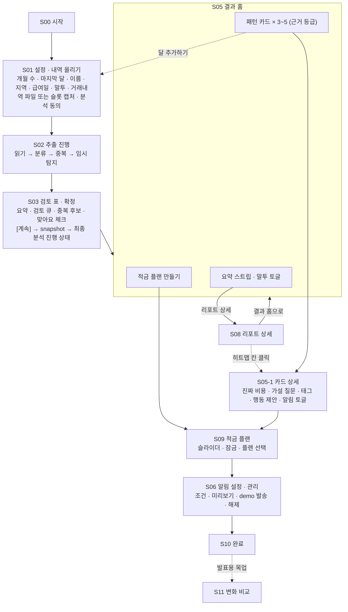
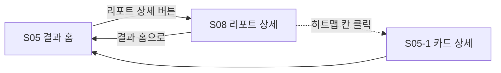

# 유저 플로우

소비 습관 분석 서비스 · 1호선톤

| 항목 | 내용 |
|---|---|
| 버전 | v1.2 (2026-11-12) |
| 변경 | v1.2: S01에 거래내역 파일 업로드(주 경로)와 이름 입력 추가, S02 읽기 단계 문구 분기, S03 검토 큐 항목에 추출 플래그 반영. v1.1: S03 검토 큐 전체 확인과 [계속] 뒤 최종 분석 진행 상태, S09 플랜 선택 시 알림 자동 활성화, S06 "플랜에서 켜짐" 표시 |
| 관련 문서 | `FunctionalSpec.md` (F01~F18), `function.md` (탐지 규칙) |
| 기준 | 모바일 390px. 화면 ID는 디자인 프레임과 API 매핑에 공통으로 사용한다 |

---

## 1. 전체 흐름



실선은 기본 흐름, 점선은 선택 경로다. S05 결과 홈이 중심이며, 어느 카드도 열지 않고 리포트나 플랜으로 갈 수 있다. 사용자에게 강제되는 상호작용은 없다.

**ID 규칙.** S04와 S07은 비워둔다. S04는 결과 유형(카드/리포트)을 고르는 단계를 두지 않기로 설계했기 때문이고, S07(알림 관리)은 S06에 통합했기 때문이다. 번호를 재배치하지 않는 이유는 디자인 프레임과 API 매핑이 같은 ID를 쓰기 때문이다.

---

## 2. 화면 목록

| ID | 화면 | 관련 기능 | 우선순위 | 핵심 요소 |
|---|---|---|---|---|
| S00 | 시작 | - | P0 | 서비스 한 줄 설명, 시작 버튼 |
| S01 | 설정 · 내역 올리기 | F01, F02 | P0 | 개월 수, 마지막 달, 이름(권장), 지역(선택), 급여일(선택), 말투, 거래내역 파일 추가(주 경로), 자동 배정 슬롯에 캡처 추가(보조), 분석 동의 |
| S02 | 추출 진행 | F03, F07, F08, F09, F18 | P0 | job 상태 4단계 표시. 파일별 성공·실패 |
| S03 | 검토 표 · 확정 | F04, F05, F06 | P0 | 요약 한 줄, 확신 낮은 행, 중복 후보 한 줄, 수정하기(접힘), 맞아요 체크박스 |
| S04 | (예약) | - | - | 사용하지 않음 |
| S05 | 결과 홈 | F10, F11, F12, F16 | P0 | 요약 스트립, 말투 토글, 카드 3~5장, 잠김 카드, 달 추가하기, 플랜 버튼 |
| S05-1 | 카드 상세 | F12, F13, F14 | P0 | 진짜 비용, 증거 3건, 가설 질문, 태그(복수·추천 3개), 행동 제안, 알림 토글 |
| S06 | 알림 설정 · 관리 | F14 | P1 | 규칙 목록, 조건·시각, 미리보기, demo 발송, 해제 |
| S07 | (예약) | - | - | S06에 통합 |
| S08 | 리포트 상세 | F15, F16, F18 | P1 | 범위·합계, 총평, 비중, 추이, 관찰, 행동 1~3개, 한계, 정기결제. 히트맵은 P2 |
| S09 | 적금 플랜 | F17, F18 | P1 | 목표 슬라이더, 카테고리·정기결제 잠금, 플랜 2~3개 |
| S10 | 완료 | - | P0 | 요약, 다음 방문 안내 |
| S11 | 변화 비교 (목업) | - | 발표용 | 합성 데이터 "한 달 뒤" 화면. 개발 범위 밖 |

---

## 3. 메인 플로우 (첫 방문)

### 3.1 S00 시작

| 사용자 | 시스템 |
|---|---|
| 서비스 설명을 읽는다 | "소비 내역 캡처를 올리면, 당신도 모르는 습관을 찾아드립니다" |
| [시작하기] | S01로 이동 |

### 3.2 S01 설정 · 내역 올리기

| 사용자 | 시스템 |
|---|---|
| 개월 수를 고른다 (1 / 2 / 3) | 기본 3개월. 선택 수만큼 빈 슬롯 표시 |
| 마지막 달의 연도와 월을 고른다 | 즉시 검증. 이번 달·미래 달은 거부하고 사유 표시. 통과하면 앞 달이 자동으로 이어져 슬롯에 배정 (예: 10월 → 8·9·10월) |
| 거래내역 파일을 올린다 (주 경로) | 은행 앱에서 내보낸 xlsx. 발급 파일에 걸린 열기 암호를 같이 입력. 파일 하나가 여러 달을 덮으므로 슬롯과 무관하게 올리고, 시스템이 슬롯 달만 골라 각 슬롯에 "파일에서 90건"처럼 표시. 암호가 틀리면 그 파일만 거부. 발급 방법 안내 링크(토스: 계좌 → 관리 → 문서 → 거래내역서 → 엑셀) |
| (보조) 각 슬롯에 캡처를 넣는다 | 파일로 받을 수 없는 앱(간편결제, 일부 카드사)용. 마지막 달이 정해진 뒤에만 가능. 회당 10장·장당 10MB·JPG/PNG/WebP. 파일별 accepted/rejected 표시 |
| (권장) 이름을 입력한다 | "이체 상대가 본인인지 구분하는 데만 쓰고, 캡처·파일에서 이름은 저장하지 않습니다" 안내. 비우면 본인 계좌 이동이 일반 이체로 잡혀 검토 표에서 고치게 됨 |
| (선택) 지역을 고른다 | 날씨 패턴 활성화. 건너뛰면 날씨만 생략 |
| (선택) 급여일을 고른다 | 1~31 또는 말일. 입력하면 "급여 후 3일" 패턴 활성화 |
| 말투를 고른다 | 담백한 코치(기본) / 친한 친구 / 직설적인 할머니. 미리보기 문장은 예시임을 표시 |
| 분석 동의를 체크한다 | "캡처·파일에 금융 정보가 포함되며 분석을 위해 외부 AI에 전송됩니다. 잔액·계좌번호·이름은 추출하지 않습니다" 안내. 체크 전 [분석 시작] 비활성 |
| [분석 시작] | 파일도 캡처도 없는 슬롯이 있으면 "9월이 비어 있어요. 그대로 진행할까요?" 확인 후 S02로 이동 |

**화면 목업.**

```
┌─────────────────────────────────────────┐
│ 몇 달치를 올릴까요?                       │
│ [ 1개월 ]  [ 2개월 ]  [ 3개월 · 추천 ]    │
│                                         │
│ 마지막 달   [2026년 ▾] [10월 ▾]          │
│ 가장 최근 달을 고르면 앞 2개월이          │
│ 자동으로 이어져요.                       │
│                                         │
│ 거래내역 파일        [ 파일 올리기 + ]   │
│   토스뱅크_거래내역.xlsx  비밀번호 [••••••]│
│   은행 앱에서 엑셀로 내보내는 방법 보기 › │
│                                         │
│ 1  2026년 8월   파일에서 167건  [캡처 +] │
│ 2  2026년 9월   파일에서 108건  [캡처 +] │
│ 3  2026년 10월  파일에서 90건   [ 3장 + ]│
│   간편결제·카드사 앱은 캡처로 추가하세요  │
│                                         │
│ 긴 기록을 올릴수록 더 많은 습관을 찾을 수 있어요
│   1개월  소비 요약 · 연쇄 소비            │
│   2개월  요일 패턴 · 정기결제             │
│   3개월  날씨 패턴 · 근거 강함 등급       │
│                                         │
│ 이름 (권장)  [ 홍길동        ]           │
│   이체 상대가 본인인지 구분할 때만 써요   │
│ 지역 (선택)  [ 서울 ▾ ]                  │
│ 급여일 (선택) [ 25일 ▾ ]                 │
│ 말투  (●코치) ( 친구) ( 할머니)           │
│   "목요일 밤 배달, 13주 중 11주예요." 예시 │
│                                         │
│ ☐ 캡처·파일에 금융 정보가 포함되며 분석을 │
│   위해 외부 AI에 전송됩니다. 잔액·계좌번호·│
│   이름은 추출하지 않습니다. 동의합니다.   │
│                                         │
│              [ 분석 시작 ]               │
└─────────────────────────────────────────┘
```

**슬롯 구조인 이유.** 캡처의 "10.23" 같은 날짜에는 연도가 없다. 사용자가 마지막 달을 고르면 슬롯이 연·월을 확정하므로 AI가 추정할 필요가 없다. 이번 달은 거래가 쌓이는 중이라 선택할 수 없다. 앞 달이 자동으로 이어지므로 달이 끊긴 입력은 만들 수 없다. 서버에는 시작일·종료일로 변환해 보낸다.

**파일이 주 경로인 이유.** 캡처를 여러 장 찍어 올리는 수고가 가장 큰 이탈 요인이다. 은행 앱의 거래내역 엑셀은 앱 안에서 바로 발급되고 한 달 치가 파일 하나라 업로드가 한 번으로 끝난다. 파일은 열 단위로 읽어 금액 오독이 없고, 잔액·상대 계좌번호 열은 읽지 않는다. 캡처는 내보내기가 없는 간편결제·카드사 앱을 위해 남긴다.

### 3.3 S02 추출 진행

| 단계 | 표시 문구 | 담당 |
|---|---|---|
| 1 | "거래내역을 읽고 있어요" (파일) / "캡처를 읽고 있어요 (3/8)" (캡처) | AI 서비스 (파일은 코드 파서, 캡처는 비전 모델) |
| 2 | "가맹점을 분류하고 있어요" | AI (텍스트) + 백엔드 캐시 |
| 3 | "중복을 정리하고 있어요" | 백엔드 |
| 4 | "패턴을 찾고 있어요" | 백엔드 |

사용자 행동 없음. 캡처 일부가 거래 화면이 아니면 S03에서 "1장은 소비 내역이 아니어서 건너뛰었어요"를 표시한다. 전부 그런 경우(no_transactions)는 S01로 돌아가 캡처 교체 안내. 일시 오류로 실패한 장은 자동 재시도(최대 2회) 뒤 남은 실패만 S03에서 "읽지 못한 캡처 1장"으로 표시하고 부분 진행을 허용한다. 완료 시 S03으로 자동 이동.

### 3.4 S03 검토 표 · 확정

| 사용자 | 시스템 |
|---|---|
| 요약을 본다 | "거래 87건 · 지출 1,243,500원 (검토 중) · 업로드한 8~10월 기록 기준 · 슬롯 3개" |
| 검토 큐를 확인한다 | 확신 낮은 행, 필수값 누락, 슬롯 월 불일치, 방향 불명 행을 2~3개씩 순차 노출(5개 초과면 한 번에 펼침). 날짜를 못 읽은 행은 캡처별로 묶어 날짜 한 번 입력. 각 행을 수정·그대로 두기·제외 중 하나로 확인. 모두 확인해야 아래 체크박스 활성. 필수값 누락은 그대로 두기 불가. 파일에서 온 행은 큐에 거의 오르지 않음 |
| 중복 후보 한 줄을 본다 | "중복 후보 3건을 같은 거래로 묶었어요 [펼쳐서 확인]". 펼치면 그룹별 "같은 거래 / 서로 다른 결제" 토글. 기본값은 같은 거래 |
| (선택) [수정하기]를 펼친다 | 전체 표. 날짜·시각·매장·금액·방향·카테고리 수정, 행 제외·복원 |
| "맞아요. 건수와 합계를 확인했어요" 체크 | 체크 전 [계속] 비활성 |
| [계속] | snapshot 생성 → 같은 화면에 "최종 분석 중" 진행 상태(집계 → 탐지 → 설명) → 완료 시 S05. 원본 이미지·파일 삭제 등록 |

**화면 목업.**

```
┌─────────────────────────────────────────┐
│ AI가 읽은 결과                           │
│ 거래 87건 · 지출 1,243,500원 (검토 중)    │
│ 업로드한 8~10월 기록 기준 · 슬롯 3개      │
│                                         │
│ 확신이 낮은 행 2개만 확인해주세요         │
│ ┌ 09/07 GS25 역삼점   [ 8,900 ] 3,900? ┐ │
│ ┌ 10/03 (주)우아한형제들 [27,000] 21,000?┐│
│                                         │
│ 중복 후보 3건을 같은 거래로 묶었어요      │
│                        [펼쳐서 확인 ▸]  │
│                                         │
│ ▸ 수정하기 (전체 표 보기)                │
│                                         │
│ ☐ 맞아요. 건수와 합계를 확인했어요.       │
│   체크해야 다음 단계로 넘어갈 수 있어요.  │
│                                         │
│              [ 계속 ]                   │
└─────────────────────────────────────────┘
```

**원칙.** 전체 표는 기본 숨김. 체크박스가 표 확정이며 snapshot을 만든다. 분석을 다시 시작하면 체크는 해제된다. 중복은 자동으로 영구 삭제하지 않고 기본 결정만 제시한다.

**최종 분석 단계.** S02에서 보여준 "패턴을 찾고 있어요"는 검토 전 임시 처리다. [계속] 뒤에 snapshot 기준으로 집계·탐지·설명을 다시 실행하고, 그 진행 상태를 S03 화면 안에서 보여준 뒤 S05로 이동한다. 사용자가 S03에서 중복을 분리하거나 행을 제외한 결과가 카드 수치에 반영되어야 하기 때문이다. 설명 생성이 실패해도 숫자 요약은 유지하고 설명만 다시 시도한다.

### 3.5 S05 결과 홈

| 사용자 | 시스템 |
|---|---|
| 요약 스트립을 본다 | "업로드한 8~10월 기록 기준 · 지출 1,243,500원", 배달 31% · 교통 18%, 전월 대비(슬롯 2개 이상), 총평 1문장 |
| (선택) 말투 토글을 바꾼다 | 문장만 재생성. 숫자·근거 불변 |
| (선택) [리포트 상세 →] | S08로 이동 |
| 카드를 훑는다 | 월 비용 순 3~5장. 앞면: 패턴 한 줄, 관찰 횟수, 월 비용, 근거 등급 배지 |
| 카드를 누른다 | S05-1로 이동 |
| [이 습관들로 적금 플랜 만들기] | S09로 이동 |

**화면 목업.**

```
┌─────────────────────────────────────┐
│ 업로드한 8~10월 기록 기준             │
│ 지출 1,243,500원                     │
│ 배달 31% · 교통 18% · 전월 대비 +12%  │
│ "9월부터 택시가 2배 늘었어요"          │
│ 말투 (●코치)( 친구)( 할머니) [리포트 →]│
├─────────────────────────────────────┤
│ 당신도 모르는 습관 4개               │
│ ┌─────────────────────────────────┐ │
│ │ 목요일 밤의 배달   [근거 강함]    │ │
│ │ 13주 중 11회 · 월 105,000원      │ │
│ └─────────────────────────────────┘ │
│ ┌─────────────────────────────────┐ │
│ │ 술자리의 진짜 비용 [근거 강함]    │ │
│ │ 7회 · 회당 68,000원              │ │
│ └─────────────────────────────────┘ │
│ ┌─────────────────────────────────┐ │
│ │ 비 오는 날의 택시  [근거 보통]    │ │
│ │ 비 온 11일 중 9일 · 월 54,000원   │ │
│ └─────────────────────────────────┘ │
│ ┌ ─ ─ ─ ─ ─ ─ ─ ─ ─ ─ ─ ─ ─ ─ ─ ┐ │
│   🔒 주말 오전의 카페 · 1회 관찰     │
│   한 번 더 보이면 카드가 돼요        │
│ └ ─ ─ ─ ─ ─ ─ ─ ─ ─ ─ ─ ─ ─ ─ ─ ┘ │
├─────────────────────────────────────┤
│ [이 습관들로 적금 플랜 만들기]       │
└─────────────────────────────────────┘
```

**단일 화면인 이유.** 사용자는 결과를 보기 전에 "카드"와 "리포트"의 차이를 모른다. 큰 그림을 3초 보고 핵심으로 내려가는 구조가 자연스럽다. 카드를 열지 않아도, 태깅·알림을 하지 않아도 리포트와 플랜으로 갈 수 있다. 패턴 0건이면 카드 영역에 "아직 반복되는 습관을 찾지 못했어요. 한 달 더 쌓이면 다시 찾아볼게요." 슬롯 1~2개면 하단에 "2개월을 더 추가하면 요일·날씨 패턴이 열려요 [달 추가하기 →]"(S01로 복귀, 개월 수 3, 기존 캡처 유지).

---

## 4. 카드 흐름

### 4.1 S05-1 카드 상세

| 사용자 | 시스템 |
|---|---|
| 진짜 비용을 본다 | "배달 84,000원 + 다음날 편의점·카페 21,000원" |
| 증거 거래 3건을 본다 | 날짜, 가맹점, 금액. snapshot에 있는 거래만 |
| 가설 질문을 읽는다 | "주 후반 피로 때문일까요? 그날 보통 무슨 일이 있나요?" (말투 적용) |
| 태그를 고른다 (복수) | 추천 3개가 앞에: [야근] [스트레스] [습관]. 그 뒤 [비 와서] [그냥] [직접 입력]. 아래에 [모르겠음] [해당 없음] [건너뛰기] |
| 행동 제안을 읽는다 | "주문 전 냉장고를 한 번 열어보세요" |
| 알림 토글을 켠다 | "목요일 21:00에 미리 말씀드릴게요" (예상 소비 22시의 1시간 전). 해당 없음이면 토글 비활성 |
| [다음 카드] 또는 [결과 홈으로] | |

**화면 목업.**

```
┌─────────────────────────────────┐
│ ← 결과 홈                        │
│ 목요일 밤의 배달      [근거 강함] │
│ 13주 중 11회 관찰                │
│                                 │
│ 진짜 비용  월 105,000원          │
│   배달        84,000원           │
│   다음날 후속 21,000원           │
│                                 │
│ 증거  09/10 배민 23,500          │
│       09/17 쿠팡이츠 19,800      │
│       10/01 배민 27,000          │
│                                 │
│ 주 후반 피로 때문일까요?          │
│ [야근] [스트레스] [습관]  ← 추천  │
│ [비 와서] [그냥] [직접 입력]      │
│ [모르겠음] [해당 없음] [건너뛰기] │
│                                 │
│ 💡 주문 전 냉장고를 한 번 열어보세요 │
│                                 │
│ 알림  목요일 21:00   (●  )       │
│ "오늘이 그 요일이에요. 야근 날이라 │
│  힘드시겠지만 지난 13주 중 11번   │
│  배달을 시키셨어요. 과거 기록을   │
│  참고한 사전 안내예요."           │
│              [다음 카드 →]       │
└─────────────────────────────────┘
```

**태그 입력 후.** 알림 미리보기가 즉시 갱신된다. 입력의 효과를 바로 보여주는 것이 응답률을 높인다. 저장은 카드 응답 전체 대체.

### 4.2 S09 적금 플랜

| 사용자 | 시스템 |
|---|---|
| 목표 금액 슬라이더를 움직인다 | 1초 이내 재계산. 제약 강도(여유/보통/빡빡) |
| 못 줄이는 항목을 잠근다 | 하위 태그 단위(배달·택시·카페·편의점·주점·쇼핑) + 정기결제 항목별 잠금 |
| 플랜 2~3개를 비교한다 | 배달 중심 / 택시 중심 / 균형형. 정기결제 해지 항목은 고통 점수가 가장 낮아 먼저 제안됨 (예: "유튜브 프리미엄 해지 -14,900") |
| 플랜을 선택한다 | 플랜 항목 중 요일·시각 근거가 있는 패턴의 알림이 자동으로 켜진 상태(demo)로 S06으로 이동. 정기결제 해지 항목은 알림 없이 행동 체크 항목으로만 표시 |

**화면 목업.**

```
목표  월 50,000원  ●────────○──────  여유

플랜 A  배달 중심
  목요일 밤 배달 끊기        -35,000
  유튜브 프리미엄 해지       -14,900
  택시 월 8회 → 6회          -24,000
  ─────────────────────────────────
  월 73,900원 절감 · 목표 달성

플랜 B  택시 중심
  택시 월 8회 → 3회          -60,000
  ─────────────────────────────────
  월 60,000원 절감 · 목표 달성

잠금  [배달 🔒] [카페] [택시] [쇼핑] [넷플릭스 🔒]
```

**예외.** 목표가 감축 가능 총액을 넘으면 "현재 소비 구조에서는 최대 110,000원까지 가능해요" 표시 후 슬라이더 상한 조정.

### 4.3 S06 알림 설정 · 관리

| 사용자 | 시스템 |
|---|---|
| 켜진 규칙 목록을 본다 | 카드별 요일 조건(필수), 날씨 조건(선택), 발송 시각(예상 소비 1시간 전). 플랜에서 자동으로 켜진 규칙은 "플랜에서 켜짐" 표시 |
| 시각을 조정한다 | 22:00~08:00 구간은 방해금지로 안내 |
| 미리보기를 본다 | 태그 맥락 + 필수 안내 "과거 기록을 참고한 사전 안내이며 새 결제를 감지한 결과가 아닙니다" |
| (demo) [지금 보내보기] | 인앱 알림 표시. 실발송 로그 없음 |
| 규칙을 해제한다 | 즉시 disabled |
| [완료] | S10으로 이동 |

**live 모드.** 브라우저 권한 granted + push 구독 유효 + 서비스 동의 + 최신 snapshot 연결일 때만. 해커톤 기본은 demo.

---

## 5. 리포트 상세

### 5.1 S08 리포트 상세

| 순서 | 섹션 | 우선순위 |
|---|---|---|
| 1 | 업로드 범위와 지출 합계 | P1 |
| 2 | 총평 3문장 이내 (말투 적용) | P1 |
| 3 | 카테고리 비중 (상위 7개) | P1 |
| 4 | 월별 추이 | P1 |
| 5 | 주요 관찰 (카드와 같은 근거 형식, 태깅 요구 없음) | P1 |
| 6 | 행동 제안 1~3개 | P1 |
| 7 | 한계 (업로드 없는 날, 시각 없는 거래, 날씨 생략 여부) | P1 |
| 8 | 정기결제 목록·월 합계·가격 인상. "계속 쓰고 계신가요?" 톤. 슬롯 1개면 생략 | P1 |
| 9 | 요일×시간대 히트맵 (칸 클릭 → S05-1) | P2 |

**규칙.** 열람 후 종료 가능. 카드·태깅·알림으로 강제 이동 없음.

### 5.2 이동 경로



---

## 6. 완료와 발표용 목업

### 6.1 S10 완료

| 표시 | 내용 |
|---|---|
| 요약 | 찾은 패턴 수, 답한 질문 수, 켠 알림 수, 선택한 플랜 |
| 다음 안내 | "한 달 뒤 다시 올려주시면, 얼마나 달라졌는지 보여드릴게요" |

### 6.2 S11 변화 비교 (발표용 목업)

개발 범위 밖. 합성 데이터로 "13주 중 11회 → 4주 중 1회"와 성장 지수를 보여준다. API·저장 없음. 프로토타입에는 데모 버튼으로 남긴다.

---

## 7. 예외 플로우

| 상황 | 발생 지점 | 처리 |
|---|---|---|
| 마지막 달을 이번 달·미래 달로 선택 | S01 | 즉시 거부. "2026년 11월은 선택할 수 없어요. 이번 달과 미래 달은 아직 내역이 완성되지 않았어요." 월 초기화, 슬롯 비움. 분석 시작에서 재검증 |
| 마지막 달 미선택 | S01 | 슬롯에 "마지막 달을 먼저 골라주세요", 캡처 추가 비활성 |
| 달이 연속되지 않음 | S01 | UI 상 발생 불가(자동 배정). 서버 재검증 |
| 분석 동의 미체크 | S01 | [분석 시작] 비활성. 서버는 403 CONSENT_REQUIRED |
| 파일 형식·용량·개수 초과 | S01 | 해당 파일만 거부, 사유 표시 |
| 캡처 0장 슬롯 | S01 | "2026년 9월이 비어 있어요. 그대로 진행할까요?" 확인 후 허용 |
| 소비 내역이 아닌 이미지 | S02 | 해당 이미지 제외, S03에서 "1장은 건너뛰었어요" |
| 추출 partial | S02 | 성공 파일만 S03. 실패 자산만 재시도 |
| 추출 전체 실패 | S02 | S01로 복귀, 재시도·교체 |
| 슬롯 월과 캡처 월 불일치 | S03 | 해당 행 플래그. "10월 슬롯에 9월 캡처가 있어요. 9월로 옮길까요?" |
| 검토 큐 미확인 | S03 | 체크박스 비활성. 안내 "확인이 필요한 행을 먼저 봐주세요" |
| 포함 행의 필수값 누락 | S03 | "그대로 두기" 불가. 수정 또는 제외만 허용 |
| 최종 분석 실패 | S03 | 설명 생성 실패는 숫자 요약 유지 + 설명 재시도. 집계 실패는 같은 snapshot으로 재시도 |
| 중복 후보 미결정 | S03 | 기본값 merge로 진행 가능 |
| revision 충돌 | S03 | 수정 내용 보존 후 최신 표 다시 불러오기 |
| 시각 없는 거래 다수 | S03 | "시간대 분석은 제외돼요. 카드사 앱 캡처를 추가하면 열려요" |
| 지역 미입력 | S05 | 날씨 패턴 없이 진행. "지역을 입력하면 날씨 패턴도 찾아요" |
| 패턴 0건 | S05 | 카드 영역 안내 문구. 요약·리포트는 정상 |
| 1회 관찰 패턴 | S05 | 잠김 카드 "한 번 더 보이면 카드가 돼요" |
| 말투 변환 실패 | S05, S08 | 중립 표현으로 대체 |
| 해당 없음 태그 | S05-1 | 알림 토글 비활성, 기존 규칙 pause |
| 목표가 감축 가능액 초과 | S09 | 최대치 안내, 슬라이더 상한 조정 |
| 방해금지 시간 발송 | S06 | skip_quiet_hours. 시각 조정 안내 |
| 예보 없음 | S06 | 날씨 조건 알림은 보내지 않음 |
| AI 호출 실패 | S02, S05 | 교정 재시도 1회. 실패 시 "잠시 후 다시 시도해주세요". 요약 숫자는 코드 집계라 항상 표시 |

---

## 8. 데모 시나리오 (3분)

페르소나는 김민지(25세, 월말마다 배달이 는다). 캡처는 3개월 8장.

| 시간 | 화면 | 보여줄 것 |
|---|---|---|
| 0:00 | S01 | 3개월, 마지막 달 10월 → 8·9·10월 슬롯에 캡처 8장. 말투 "직설적인 할머니". 동의 체크. "마지막 달만 고르면 됩니다" |
| 0:25 | S02 → S03 | "87건을 읽었어요" 한 줄. 중복 후보 3건 묶임 표시. "맞아요" 체크 후 계속 |
| 0:45 | S05 | 결과 홈 한 화면. 할머니 말투 총평 3초, 카드 4장으로 시선 이동 |
| 1:00 | S05-1 | "목요일 밤의 배달" 상세. 진짜 비용 분해. "야근" 태그 → 알림 문구 즉시 갱신. 행동 제안 한 줄 |
| 1:30 | S09 | 슬라이더 5만 → 20만. 플랜이 빡빡해지는 과정. 정기결제 해지가 먼저 제안되는 모습 |
| 2:00 | S06 | 알림 미리보기에 "야근" 맥락과 필수 안내 문구. [지금 보내보기] |
| 2:20 | S05 | 말투 토글을 코치로 바꿔 같은 숫자에 문장만 바뀌는 것 보여주기 |
| 2:35 | S11 | 발표용 목업 "한 달 뒤". "11회 → 1회" |
| 2:50 | 마무리 | "찾아내고, 묻고, 말리고, 변화를 확인합니다" |
